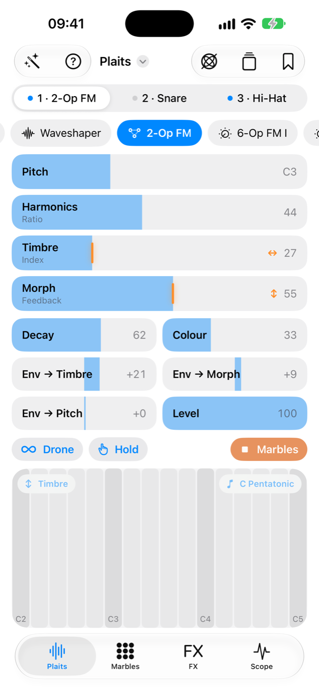
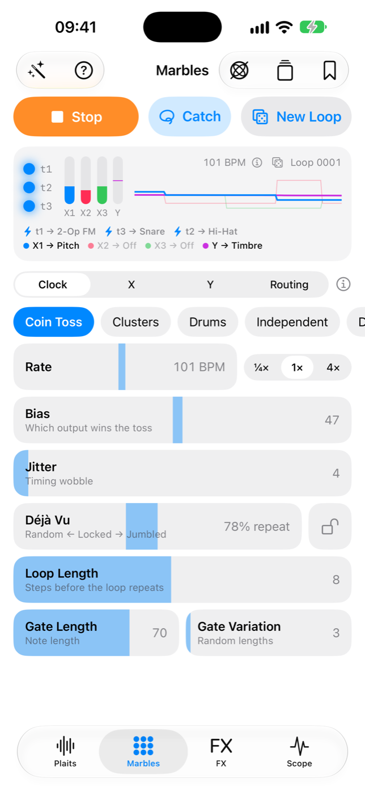
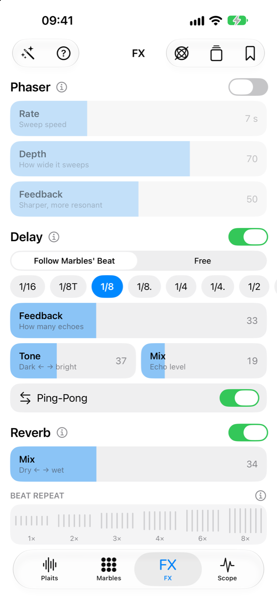
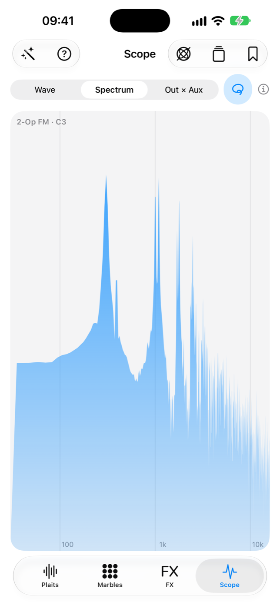

# Drift

A native iOS synth built on the DSP of two Mutable Instruments modules: **Plaits**, a
macro-oscillator with 24 engines, and **Marbles**, a random sequencer. Inspired by
Worldwave's [Wakes](https://github.com/Worldwave/Wakes) firmware for the SP-1.

<p align="center">
  
  
  
  
</p>

- Plaits and Marbles' original code, unmodified, behind a small C interface
- iPhone-native UI: sliders, a scale-locked play pad, Drone and Hold
- One voice, or three Plaits at once (each with its own engine), played by Marbles
- Marbles with Déjà Vu, New Loop, Catch, and routing of t1–t3, X1–X3 and Y
- Motion control: tilt, twist, shake and two LFOs on any slider
- FX on the whole mix: phaser, a delay that follows Marbles' beat, Rings' reverb with
  freeze, and Beat Repeat
- A Scope page: the wave, its spectrum, and Out against Aux
- Something Nice: one tap for a pleasant sound and sequence
- Saved sounds, Recent Changes with undo/redo, sharing sounds as `.drift` files, and an
  in-app Guide

## Building it yourself

You need a Mac with **Xcode 27** and [XcodeGen](https://github.com/yonaskolb/XcodeGen)
(`brew install xcodegen`). Drift runs on iPhone with iOS 26 or later.

```sh
git clone https://github.com/elliotmoore/Drift.git
cd Drift
xcodegen generate
open Drift.xcodeproj
```

**In the Simulator:** choose an iPhone simulator and press ⌘R. No account or setup needed.

**On your iPhone:** a free Apple ID is enough.

1. In Xcode, Settings → Accounts, add your Apple ID.
2. Create `Config/Local.xcconfig` (it is git-ignored, so it stays yours) with your team
   and a bundle ID nobody else uses:

   ```
   DEVELOPMENT_TEAM = ABCDE12345
   PRODUCT_BUNDLE_IDENTIFIER = com.yourname.drift
   ```

   To find your team ID: pick your team once under the Drift target's **Signing &
   Capabilities**, then copy the value Xcode shows for **Development Team** in Build
   Settings.
3. Run `xcodegen generate` again, plug in your iPhone, choose it in Xcode and press ⌘R.
   The first time, the iPhone asks you to turn on Developer Mode (Settings → Privacy &
   Security) and to trust your developer certificate (Settings → General → VPN & Device
   Management).

With a free Apple ID the app stops opening after 7 days; run it from Xcode again to renew.

The `.xcodeproj` is generated from `project.yml`: change settings there, not in Xcode.
Mutable Instruments' artwork isn't included, so the Plaits and Marbles tabs show plain
icons.

`tools/check_upstream.sh` confirms the Plaits, Marbles, Rings and stmlib files are identical to
Émilie Gillet's originals. The DSP can also be checked without Xcode:
`tools/render_test.cpp` renders every engine and the sequencer to a WAV (see the comment
at its top).

## Thanks

Drift started as an idea: a place on the phone to play with Plaits and Marbles. The hard
work was done long before, by others, and shared openly.

- **Émilie Gillet** designed Plaits and Marbles at [Mutable Instruments](https://pichenettes.github.io/mutable-instruments-documentation/)
  and released their code, with a decade of other modules, under the MIT licence. Every
  voice and every Marbles sequence Drift plays is her code, unchanged, and so is the reverb,
  from her Rings module.
- **Adara Barami / Worldwave** built [Wakes](https://github.com/Worldwave/Wakes), which put
  Plaits and Marbles together on the SP-1 and worked out how to make them play each other:
  running Marbles at Plaits' block rate, routing its outputs, and the Trig/Burst rocker.
  Drift follows Wakes closely, and takes its copy of the DSP from Wakes.
- **The SP-1 community**, whose work Wakes is built on: chattock
  ([sp1-tape-looper](https://github.com/chattock/sp1-tape-looper)), Tim Knapen
  ([SP-1-dev](https://github.com/timknapen/SP-1-dev)), Eric Lewis
  ([sp1-midi](https://github.com/ericlewis/sp1-midi)), Benjamin Reece
  ([feldd](https://github.com/bnjreece/feldd-sp1-firmware)), Ryan Gilmore
  ([sp1-usb-audio](https://github.com/ryanmgilmore/sp1-usb-audio)), and
  [solderless.engineering](https://solderless.engineering).

Put together by Elliot Moore, with [Claude](https://claude.com/claude-code) writing much
of the code.

## Credits and licence

Drift is MIT licensed (see `LICENSE`). Plaits, Marbles, Rings' reverb and stmlib are by Emilie Gillet
(MIT); some engine glue is adapted from Wakes by Adara Barami / Worldwave (MIT). See
`NOTICE`. Drift is not affiliated with Mutable Instruments or Worldwave.
